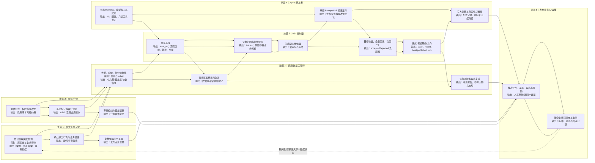

# 样例 25 · Harness RSI —— 持续演进信贷 Agent 的 Prompt 与 Skill

> 基于开源 [`openjiuwen==0.1.20`](https://github.com/openJiuwen-ai/agent-core/releases/tag/v0.1.20) 的真实 Single Harness RSI API。所有 Agent 执行、失败归因、候选生成和 LLM 评审都调用真实模型；不使用 mock LLM。案例、人员、政策编号均为虚构演示。

## 1. 场景：把“改提示词”变成可审计的演进闭环

已有信贷 Agent 可能出现漏算偿债收入比、当前逾期仍建议通过、资料缺失时编数等问题。本样例不重写 Agent，也不自拼优化算法，而是把现有 Agent 的 Prompt 与 Skill 导出成官方 Plugin Harness，再交给 `SingleHarnessIterativeOptimizationOrchestrator`：

**业务入口：冻结优化集 → 官方基线评测 → 失败归因 → 候选生成 → 全量回放与晋升 → 输出报告。**

**独立 UT：核对运行证据 → 审计候选差异 → 官方复装 → 真实信贷冒烟 → 双版本留出集复验。**

本轮边界：

- 可演进：`prompt_sections/**`、`skills/**` 及它们在 `manifest.json` 中的同步声明；
- 禁改：Tool、Rail、Config、真实信贷政策、审批权限、放款规则；
- 工具可以作为既有只读能力接入，但本样例把案例事实内嵌在输入中，未注册真实企业工具；
- 只产生本地候选/发布包，不自动部署生产，不代替有权审批人。

与样例 17 的区别：17 演示一次 LLM-as-Judge 评分；本样例使用官方 RSI 控制面完成基线、归因、候选、门禁、版本和发布证据管理。与 AutoHarness 的区别：本样例不做 Git/CI/PR 编码演进。

## 2. 怎样集成进现有信贷 Agent

| 集成动作 | 本样例位置 | 官方 API / 契约 |
|---|---|---|
| 导出初始 Harness | `harness/credit_review/` | Plugin `manifest.json`；Prompt 用 `prompt_sections[].file`，Skill 用 `skills[].dir` |
| 声明唯一优化角色 | `harness/harness_refs.yaml` | `harness_refs.solver` 恰好一个 |
| 冻结优化集与评分 | `data/optimization_cases.json` | `reference.answer/required_behaviors/forbidden_behaviors` |
| 保留独立留出集 | `data/holdout_cases.json` | 不传给 orchestrator，只给最终复验 |
| 配置执行/分析/优化/裁判模型 | `config/model.yaml`、`config/rsi.yaml` | `AutoCoordinatingHarnessConfig.from_dict()` |
| 执行 RSI 闭环 | `main.py` | `IterativeSingleHarnessRequest` + `SingleHarnessIterativeOptimizationOrchestrator.run()` |
| 验收最终包复装 | `test.py` | `find_plugin_manifest()` + `load_plugin_package()`；真实评测后端内部调用 `DeepAgent.load_plugin()` |
| 基线/最终留出复验 | `test.py` | `TeamEvaluator.evaluate_batch()`，同一冻结协议、同一留出集分别运行 |

核心调用形态如下；业务流程见 `main.py`，独立验收见 `test.py`：

```python
config = AutoCoordinatingHarnessConfig.from_dict(rsi_config)
request = IterativeSingleHarnessRequest(
    dataset_files=[optimization_cases],
    harness_refs_path=initial_refs,
    output_dir=run_directory,
    auto_full_baseline=True,
    max_iteration=1,
    task_id=task_id,
)
result = await SingleHarnessIterativeOptimizationOrchestrator(config).run(request)
```

`main.py` 的 `prepare_run()` 准备模型配置、任务目录与官方请求，`run()` 直接调用官方编排器，`main()` 展示发布状态、分数和报告路径。任务名和新建/恢复目录检查属于入口配置校验。报告一致性、包差异、六段输出检查、留出集和强制提分验收均在 `test.py`，业务代码不导入测试模块。

目录结构（保留旧样例单语言布局）：

```text
25_harness_rsi/
├── main.py                 # 配置、官方 RSI 调用、结果展示
├── test.py                 # unittest：规则单测与真实模型集成验收
├── config/                 # 官方配置结构、环境变量占位
├── harness/                # 初始 Prompt 与 Skill 包
├── data/                   # 优化集与独立留出集
├── materials/              # 企业交接模板与虚构示例
├── runs/                   # 每次任务的官方产物；UT 留出评测也写入此处
├── offline_test_output.txt # 根目录离线 UT 实测记录
├── test_output.txt         # 当前真实模型回归实测记录
└── run_output.txt          # 历史运行记录，不代表当前重构已验收
```

`ui/` 是已有演示界面，本次入口与 UT 分离不依赖它。

### 关于 0.1.20 的可编辑面限制

`config/rsi.yaml` 的 `action_group_configs: [prompt, skill]` 表达本实验范围，但 **0.1.20 的 Single Harness 构造器会把内建 action group 白名单扩展为 prompt/skill/tool/rail/config**，不能只凭 YAML 宣称其他面已被原生禁止。

因此本样例同时采取两层约束：

1. 初始包只暴露 Prompt/Skill，不提供 Tool/Rail/Config 编辑目标；
2. `test.py` 对所有候选和最终包做路径级差异审计，发现禁改内容即验收失败；官方生成的空 Tool/Rail 注册表会被识别为无资源变化。

这是**UT 中的事后验收，不是业务入口的发布拦截器，也不是候选执行前的安全沙箱**。企业生产若需要控制面原生、预防式地只开放 Prompt/Skill，应向 agent-core 提 Issue/PR，把权限约束做进框架本体，而不是在样例仓私封装控制面。

## 3. 全流程六角色泳道图



## 4. 每个阶段谁得到什么、必须输出什么

| 阶段 | 参与者得到什么 | 必须输出 | 签收/下一步 |
|---|---|---|---|
| 立项 | 失败反馈、当前 Harness、政策红线、工具契约 | 数据脱敏结论、冻结优化章程、可编辑面与预算 | 业务＋合规＋研发签收；缺任一项不启动 |
| 基线 | 冻结优化集、评审协议、初始 Harness、模型配置 | 全量 baseline `eval_ref`、逐案结果、轨迹、分数、用量 | 数据工程师确认覆盖完整；基础设施错误先修环境 |
| 归因 | 失败答案、评分维度、轨迹、案例参考 | 带证据 issue、影响 case、优化假设 | 脏数据/评审故障返回立项或基线，不生成业务候选 |
| 候选 | 已确认 issue、当前 Harness、允许编辑面 | 版本化 Prompt/Skill diff、候选 refs | 开发者审查差异；禁改面出现即失败 |
| 门禁 | 候选、目标案例、冻结优化全集、晋升阈值 | 目标验证、全量回放、accepted/rejected、退化原因 | 只有证据一致且达阈值才允许发布 |
| 发布复验 | 最优或保留版本、独立留出集、发布单 | 官方复装、真实信贷冒烟、基线/最终留出报告 | 无提升则保留基线；生产仍需人工审批 |
| 运营 | 新失败、漂移、监测告警 | 新数据版本、监测记录或回滚记录 | 改任何冻结输入就新建 task-id，不改写旧证据 |

## 5. 企业需要提供的物料：模板、示例与交接

`materials/` 中每组都有空白 `template` 和填好的虚构 `example`。示例不是实测输出；真实审批单必须引用真实运行文件。

| 物料 | 企业责任人 | 何时提供 | 交给谁 / 映射到哪里 | 模板与完整示例 |
|---|---|---|---|---|
| 案例登记 `case-intake` | 信贷业务专家 | 立项、每轮新增失败 | 数据工程师；映射为 `case_id/input/reference` 和脱敏标记 | [模板](materials/case-intake.template.json) / [示例](materials/case-intake.example.json) |
| 评审规则 `judge-rubric` | 业务专家＋风控/合规 | 基线前冻结 | 数据工程师；映射为加权 `required_behaviors`、扣分 `forbidden_behaviors`、政策版本 | [模板](materials/judge-rubric.template.json) / [示例](materials/judge-rubric.example.json) |
| 失败反馈 `failure-feedback` | 运营/客户经理/业务专家 | 发现线上问题后 | 业务与数据工程师；形成原输出、轨迹证据、期望行为和 case-intake | [模板](materials/failure-feedback.template.md) / [示例](materials/failure-feedback.example.md) |
| 工具契约 `tool-contract` | Agent 开发者＋工具系统负责人 | 导出 Harness 前 | 开发与评测；定义字段、空值、错误、权限、超时，本轮只读 | [模板](materials/tool-contract.template.yaml) / [示例](materials/tool-contract.example.yaml) |
| 优化章程 `optimization-charter` | 业务＋合规＋研发 | 实验启动前 | RSI 控制面与审批人；冻结范围、预算、阈值、故障和回滚原则 | [模板](materials/optimization-charter.template.yaml) / [示例](materials/optimization-charter.example.yaml) |
| 发布审批 `release-approval` | 发布审批人/运维 | 留出复验完成后 | 企业发布流程；记录真实证据、决定、上线窗口、监测和回滚版本 | [模板](materials/release-approval.template.md) / [示例](materials/release-approval.example.md) |

### 案例与评分字段如何落到数据集

```json
{
  "case_id": "opt-current-overdue",
  "synthetic": true,
  "deidentified": true,
  "input": "脱敏或虚构的完整任务事实",
  "reference": {
    "answer": "业务专家确认的参考结论",
    "answer_role": "reference",
    "penalty_mode": "subtract",
    "policy_version": "DEMO-CREDIT-2026.1",
    "required_behaviors": [
      {"id": "ratio", "description": "正确计算并展示口径", "weight": 0.25}
    ],
    "forbidden_behaviors": [
      {"id": "direct_approval", "description": "触碰当前逾期红线", "penalty": 1.0}
    ]
  }
}
```

上例仅展示字段形状；完整评分项见数据集。`answer_role: reference` 防止参考答案被额外作为一个重复计分项；正向权重合计 1，扣分来自冻结数据而不是裁判临时决定。优化集和留出集的 `case_id` 不得重叠。

## 6. 运行

### 前提

- Python 3.11–3.13；
- 安装 `openjiuwen==0.1.20`；
- 一个真实 OpenAI 兼容模型网关；执行、分析、优化、裁判默认同一个模型，可分别覆盖；
- 模型应具备稳定指令遵循和 JSON 输出能力。RSI 的多次 Agent 调用比单轮样例耗时、耗 token，请先在样例预算下验证。

```bash
python -c "import openjiuwen; print(openjiuwen.__version__)"
cd samples/25_harness_rsi
export API_BASE="https://你的网关/v1"
export API_KEY="你的密钥"
export MODEL_NAME="你的模型"
python main.py
```

运行前必须设置这三个变量；密钥由官方模型加载器从环境变量展开，不写入 YAML 或摘要。

可选模型角色覆盖：

| 环境变量 | 用途 |
|---|---|
| `RSI_EVALUATION_MODEL_CONFIG` | 信贷 Agent 执行模型配置 |
| `RSI_ANALYSIS_MODEL_CONFIG` | 失败归因模型配置 |
| `RSI_OPTIMIZATION_MODEL_CONFIG` | 候选生成模型配置 |
| `RSI_JUDGE_MODEL_CONFIG` | LLM 裁判模型配置 |

每个覆盖文件采用与 `config/model.yaml` 相同的官方结构。默认小预算为 1 epoch、batch size 2、单并发、执行/裁判各最多 8 次迭代；这些不是企业生产阈值。

### 新运行与恢复

```bash
# 推荐显式命名，便于审批单引用
RSI_TASK_ID=credit-rsi-demo-001 python main.py

# 仅当数据、Harness、评分协议等指纹不变时恢复原任务
RSI_TASK_ID=credit-rsi-demo-001 RSI_RESUME=1 python main.py

```

修改数据、Prompt/Skill 初始包、政策版本或评分协议后，必须换一个新 `RSI_TASK_ID`，不要恢复旧任务。是否满足验收条件由独立 UT 判断，业务入口只展示官方返回结果。

## 7. 产物与验收

运行产物写入本地 `runs/<task-id>/`：

```text
runs/<task-id>/
├── single_harness_state.yaml       # 可恢复状态与候选门禁
├── single_harness_report.yaml      # 基线、最佳、发布、用量与证据路径
├── frozen_baseline/                # 或 report 指向的全量基线目录
├── member_optimizations/           # 候选、版本包及差异证据
├── published/                      # 有合格发布时生成
└── holdout/                        # 仅 test.py 运行时产生
    ├── baseline/eval_ref.yaml      # 独立留出集：初始 Harness
    └── final/eval_ref.yaml         # 独立留出集：最终 Harness
```

### 如何运行验收

在仓库根目录执行：

```bash
# 离线 UT：输入数据、配置、引用路径、验收规则；不调用模型
python -m unittest discover -s tests -p test_harness_rsi_sample.py -v

# 完整 UT：规则单测 + 真实模型 RSI + 官方复装 + 双版本留出集
# 必须先设置 API_BASE / API_KEY / MODEL_NAME
python samples/25_harness_rsi/test.py

# 同样运行 test.py；回归调度器优先选择旧样例的独立测试入口
python run_all_samples.py 25

# 只在 UT 中额外要求真实提分且官方发布
REQUIRE_IMPROVEMENT=1 python samples/25_harness_rsi/test.py
```

UT 每次使用新的 `credit-rsi-ut-<时间戳>` 任务名保留真实证据，不复用或覆盖业务运行目录。连接错误、裁判错误或验收不满足时测试失败，回归脚本返回非零。测试内的报告和包文件夹具只用于验证验收规则，不充当任何模型输出或实测效果。

完整 UT 通过必须同时证明：

1. 官方 orchestrator 完成，基线和最佳证据覆盖 4 个优化案例；
2. accepted/published 都有对应的候选、全量回放和改进证明；
3. `not_published_no_improvement` 时发布路径为空，最终选择基线/最佳保留版本，**这是合法完成，不伪造提分**；
4. 官方加载器能读回最终 Prompt 和 Skill；
5. 最终包真实执行留出案例，答复含六段贷前结构；
6. 基线与最终 Harness 分别完成 2 个独立留出案例复验，报告真实分数，不宣称小样本波动具有统计显著性。

业务答案得分低但执行与评审正常，可以是有效证据；连接失败、模型超时、裁判输出不可修复、skipped/inconclusive 不是业务低分，不能据此促成发布。

## 8. 发布、人工审批与回滚

官方 `published` 只表示候选通过本轮机器门禁，**不等于企业生产批准**。生产发布还必须由信贷业务、风控/合规、Agent 开发者和发布审批人共同签收 `release-approval`，核对：

- state/report、候选 diff、全量回放、留出集和真实冒烟证据；
- 政策版本、禁改面校验、模型与数据版本；
- 上线窗口、监测指标、告警负责人和观察期；
- 可加载的回滚版本及明确触发条件。

若出现红线命中、禁改面变化、证据缺失或线上异常，停止发布/切回审批单记录的基线 refs，并保留失败 task-id 供复盘。无提升时无需回滚，因为根本没有发布新版本。

## 9. 实测输出

2026-11-03，Python 3.12、`openjiuwen==0.1.20`：

- 仓库根目录离线 UT：17 项通过，其中 13 项属于 sample25、4 项属于回归调度器；完整输出见 [offline_test_output.txt](offline_test_output.txt)。
- `run_all_samples.py 25`：运行独立 `test.py`，13 项规则测试通过，1 项真实模型集成测试报错，退出码 1，耗时 446.8 秒；记录见 [test_output.txt](test_output.txt)。
- 模型服务：本机 LM Studio，`http://127.0.0.1:1234/v1`，`google/gemma-4-e4b`；普通对话诊断可回复，RSI 中前三个基线案例收到 HTTP 400，第四个案例完成真实执行与评审。
- 官方基线比较阶段抛出以下异常，任务状态为 `failed`、发布状态为 `not_published`。候选、复装与留出集尚未完成，不能把本次分数解释为有效业务质量或提分效果。

```text
openjiuwen.rsi.harness_rsi.evaluator.errors.EvaluationInfrastructureError: Baseline is missing its original judged-artifact manifest

Ran 14 tests in 445.096s

FAILED (errors=1)
```

本次官方产物目录：`runs/credit-rsi-ut-20261103T063112302358Z/`。样例没有吞掉异常、把模型错误当业务低分，也没有修改官方包或自建优化循环。

`main.py` 是离线演进任务入口，运行者提供的业务输入是 `data/optimization_cases.json` 中经过业务确认的案例与评分协议。运行时输入/输出步骤：

1. 运行者准备优化集、初始 Harness、模型配置，并选择任务名或恢复原任务。
2. 执行 `python main.py`，官方编排器读取这些输入并执行演进。
3. 入口展示发布状态、基线与最佳分数、最佳包、任务状态与报告路径，供运行者查阅。
4. 执行独立 UT 获取验收结果；留出集由 UT 使用，不进入业务优化请求。

此入口不发起客户对话；客户问题不会在业务代码中硬编码或模拟用户回答。完整业务运行尚未验收通过，故暂无成功运行记录。
