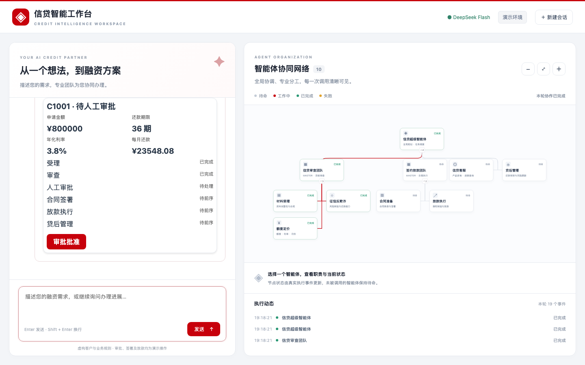
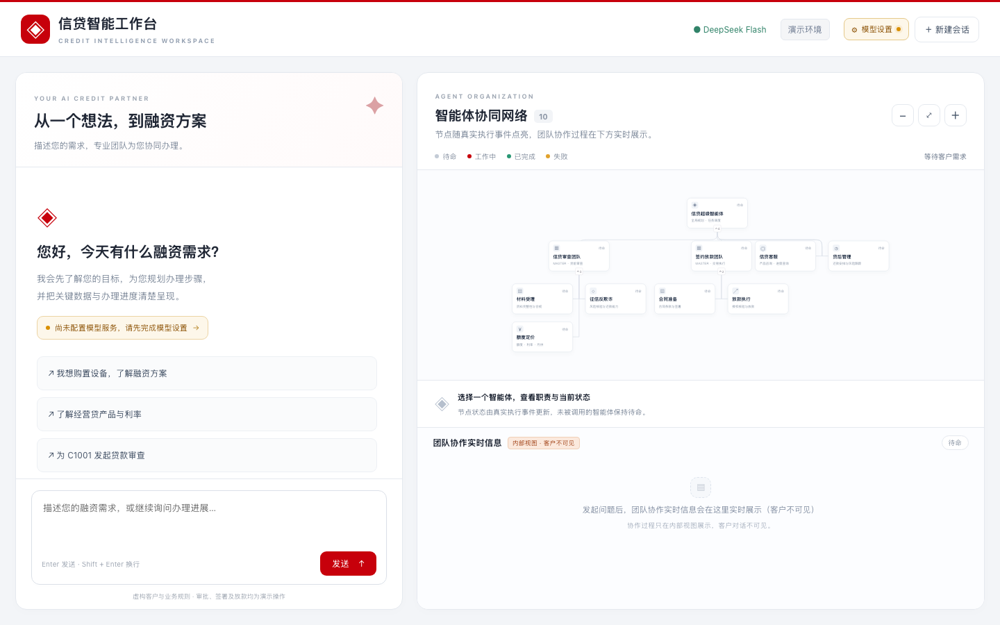
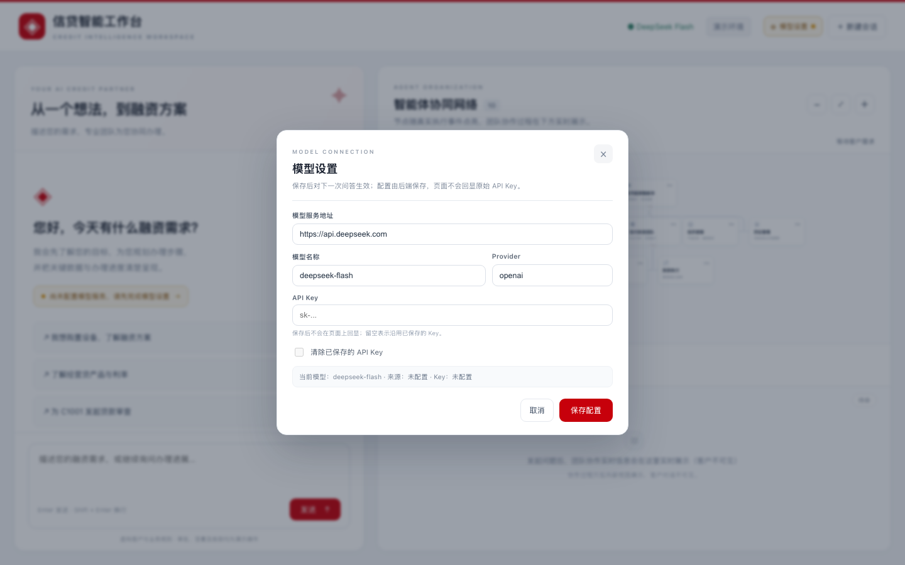
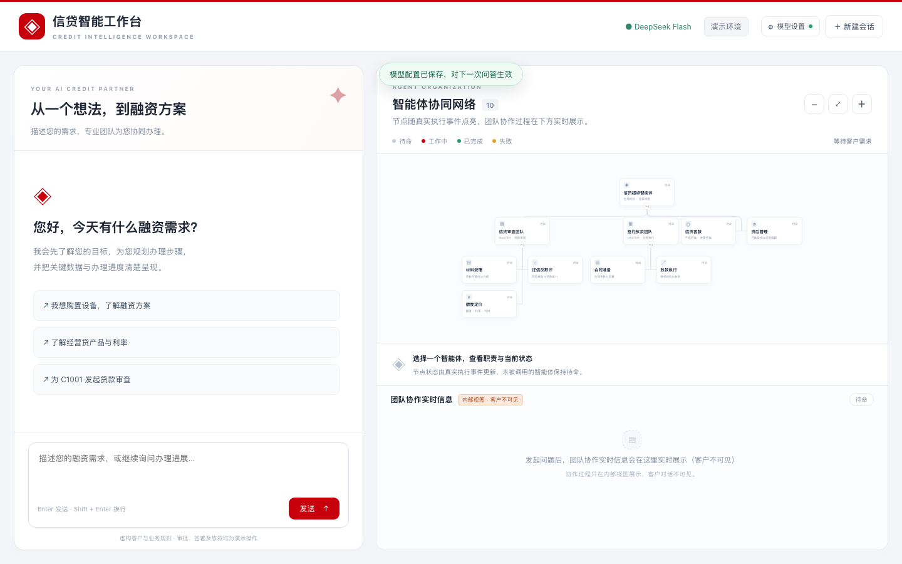
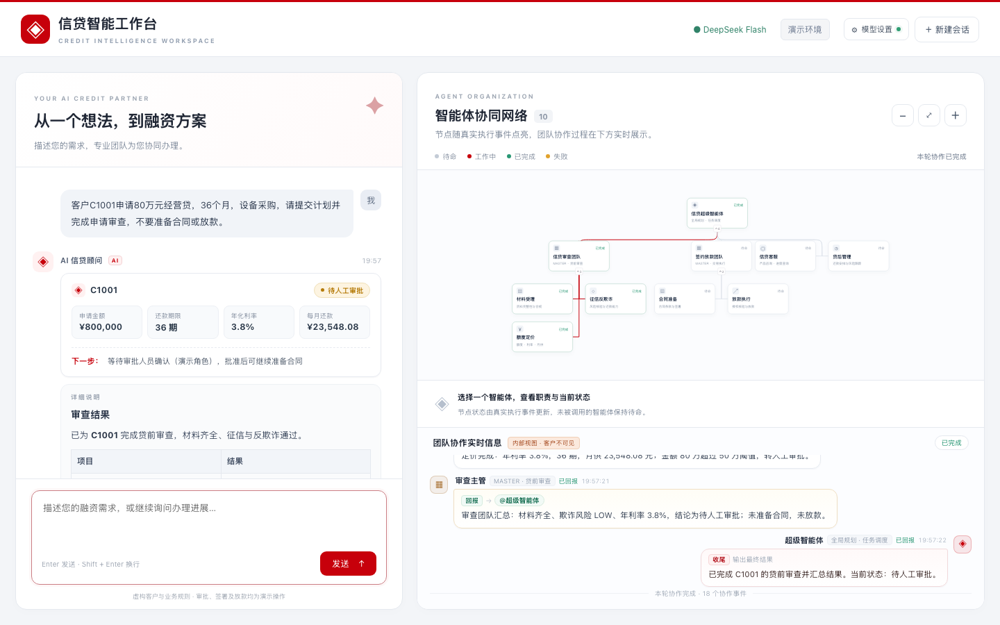
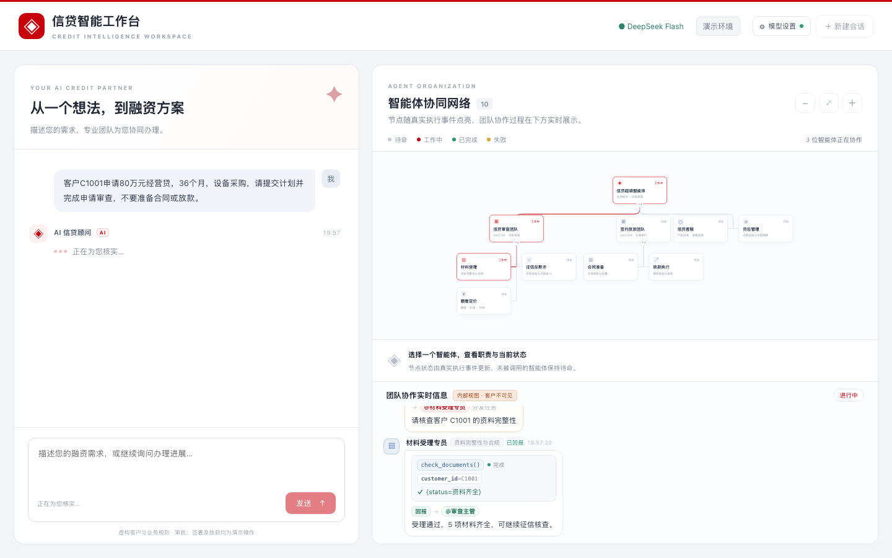
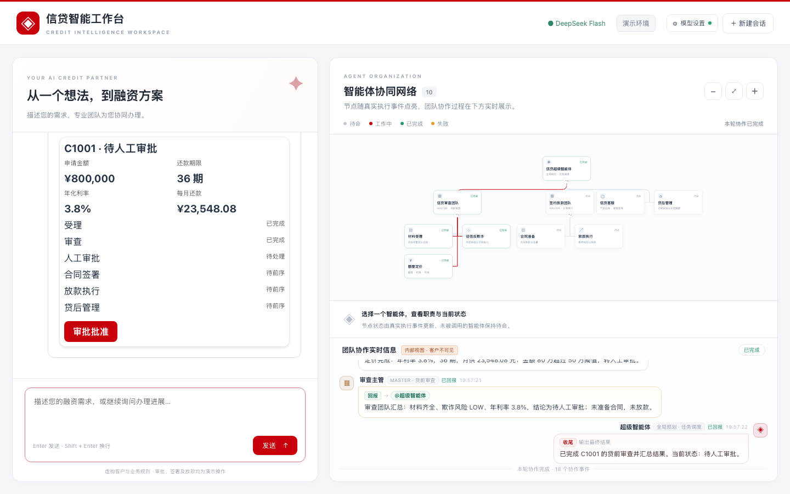
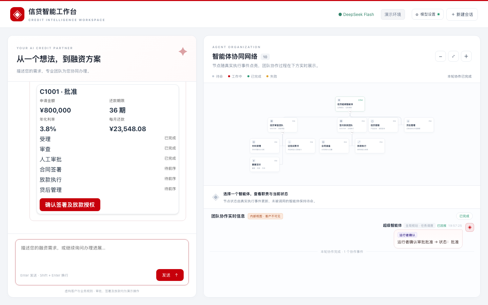
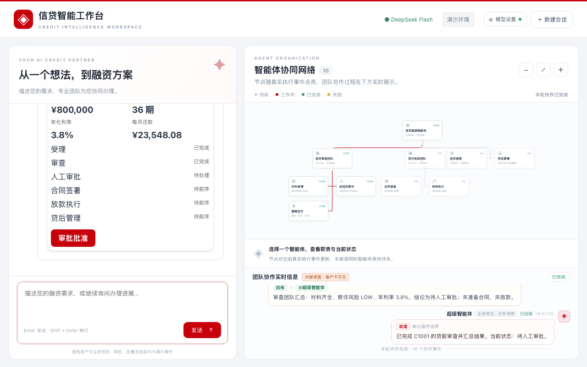

# 27 信贷超级智能体：全流程委派与实时智能体树

Java 依赖 `com.openjiuwen:agent-core-java:0.1.17`，JDK 17+、Maven 3.9+。Python 待实现。

三层：超级智能体澄清/规划/路由 → 预定义团队 master/sub 或独立客服 → LocalFunction 信贷业务服务。使用官方 ReActAgent、HierarchicalToolsTeam，不自建核心框架。十个 Agent 的节点始终显示，只有真实调用触发工作状态。业务数据全部虚构，无真实资金交易。

界面分两侧：左侧是**客户对话**，只出现业务结论、结构化数据卡和办理卡片，不展示任何智能体/工具内部过程（对客户是黑盒）；右侧上半部分是**智能体架构图**（外观保持不变），下半部分是**团队协作实时信息**（内部视图，实时呈现 leader 汇总/分发、专员工具调用与回报）。

## 启动

```bash
cd samples/27_credit_full_process_super_agent/java
mvn compile exec:java
```

打开 http://127.0.0.1:8080 ，点击右上角 **⚙ 模型设置**，填写模型服务地址、模型名称、Provider 和 API Key 后保存即可使用；
配置保存在本机（不写入仓库），重启服务仍生效。也可以用环境变量 `API_BASE` / `MODEL_NAME` / `MODEL_PROVIDER` / `API_KEY`
作为回退（页面里保存的配置优先）。

左侧输入问题，看客户视角的业务结论与办理卡片；右侧上半部分看智能体架构图状态，下半部分看团队协作实时信息（内部视图，客户不可见）。服务仅绑定本机，按演示需求串行执行模型请求；重启清空对话历史与虚构业务状态。刷新页面新建会话，不同页面会话各自独立。最多100个会话，每个最多约15轮，超过后重启演示服务。

> 常见启动/打开问题：① 浏览器报「连接提前中断，请稍后重试。」——通常是改了代码/事件协议后没有重启 Java 服务，页面连到旧进程；
> ② 启动报 `Address already in use`——8080 上还有一个旧服务进程，先停掉它再启动（macOS 可用 `lsof -nP -iTCP:8080 -sTCP:LISTEN` 找到 PID）。
> 模型调用报「尚未配置模型 API Key」——点右上角「⚙ 模型设置」填写 Key 后再发问题。

## 输入什么、怎么看效果

以下是**验收输入与预期行为，不是实测对话记录**。模型自然语言可能变化，应看实际调用树与业务状态。

| 顺序 | 输入或操作 | 预期效果 |
|---|---|---|
| 1 | 我想买设备，手头资金有点紧，看看能不能帮忙。 | 超级智能体追问客户编号、金额、期限、用途，不臆造审批结果。 |
| 2 | 我是客户 C1001，设备采购需要80万元，36个月，请做申请审查。 | 超级智能体展示阶段计划；审查主管与材料/征信/定价专员依次亮起；定价规则返回待人工审批。 |
| 3 | 页面客户编号选C1001，运行者以审批人员身份点击审批批准 | 状态变为批准；这是真人显式操作，模型不能代批。 |
| 4 | 请为C1001准备合同。 | 签约放款主管和合同专员亮起，合同待签署。 |
| 5 | 点击客户确认签署及放款授权，然后输入“请继续办理C1001放款。” | 放款专员工作，返回虚构账本放款回执；重复执行不重复放款。 |
| 6 | 查询C1001的还款安排。 | 贷后专员亮起，显示虚构贷后安排。 |

另外打开新页面分别验证：

- `经营贷的产品利率是多少？`：仅超级智能体与独立客服工作，审查团队保持待命。
- `客户C1002申请30万元经营贷，24个月，购买设备，请进行审查。`：征信反欺诈拒绝，不能进入合同放款。
- `客户C1003申请80万元经营贷，36个月，设备采购，请审查。`：缺经营流水与购销合同，停止后续审查；在确认区选择C1003，点击确认虚构补件齐全，然后输入“请继续审查C1003”。这是运行者对虚构资料的确认，无文件上传接口。
- `客户C1004申请20万元经营贷，24个月，设备采购，请审查。`：规则批准，无大额人工审批；签署仍需要运行者确认。

每轮发送后树状态重置为待命；服务端 BEFORE_INVOKE/AFTER_INVOKE 回调驱动“工作中/已完成”，未被调用的节点不会亮起。模型或业务错误通过页面错误消息显示。计划属于模型行为，业务前置条件由Java状态机强制执行。人工确认区是本地演示操作角色，不提供生产身份认证或电子签章验证。

## 目录与验证

`java/src/main/java/` 为业务与 HTTP 入口（`CreditWebApp` 负责 NDJSON 事件流与 `/config` 接口，`CreditAgents` 负责官方回调，`CreditSurfaces` 负责业务卡片与结论卡数据，`ModelConfigStore` 负责模型配置持久化）；页面构建产物在 `java/src/main/resources/ui/`；前端源码在 `web/src/`（`main.js` 宿主与客户对话、`collab.js` 团队协作实时信息、`style.css`/`collab.css` 样式）；Java 测试在 `java/src/test/java/`，前端测试在 `web/test/`。`python/README.md` 标注待实现。

```bash
mvn test                  # 规则/状态/事件构造测试，不调用模型（11 个用例）
mvn -Preal-model test     # 额外调用真实DeepSeek；需要API_KEY
cd web && npm test        # 前端 2 项静态/渲染协议测试
```

业务状态只在本会话内存保存，模型历史保存在服务器；申请已拒绝不允许通过重新受理绕过。金额范围1元—100万元、期限1—60月、演示年利率3.8%，月供由规则计算。C1001等不是实际客户，所有利率与规则仅用于演示。

## 实测记录（2026-11-06）

> 下表的真实模型路由/业务记录来自 2026-11-06，**三层路由与业务规则在 2026-11-11 的界面/事件流升级中没有改动**；
> 2026-11-11 的改动只涉及宿主界面与 NDJSON 事件（见文末「界面升级与验证范围」），真实模型的界面回归未在本机执行（无 API_KEY），
> 因此不在此处冒充新的实测结果。

模型服务为 DeepSeek 官方 `https://api.deepseek.com`，模型 `deepseek-flash`，关闭 thinking，使用真实工具调用。

以下来自**真实 DeepSeek 集成测试的脚本化输入，不是人工交互记录**。审批批准、签署授权由测试显式调用业务确认方法提供；实际页面使用上面的运行者确认按钮。各阶段的输入、激活 Agent 和结果节选如下；激活列表只列 Agent，不含 `tool:` 事件，列表不表示执行先后。

| 阶段与真实输入 | 实际激活 Agent | 实际结果节选 |
|---|---|---|
| `客户C1001申请经营贷800000元、36个月，用于设备采购。请提交全流程计划并完成申请审查，不要准备合同或放款。` | `credit_master`、`review_master`、`intake_agent`、`risk_agent`、`pricing_agent` | 资料齐全；逾期0，月收入60000元、现有月负债5000元、欺诈风险LOW；年利率3.8%，月供23548.08元；待人工审批；没有合同或放款。 |
| 测试显式批准后，输入 `客户C1001的800000元36个月设备经营贷已由运行者审批批准，请查询状态并准备合同，不要放款。` | `credit_master`、`service_agent`、`execution_master`、`contract_agent` | 查询到批准，合同待签署；没有放款。 |
| 测试显式签署授权后，输入 `客户C1001的800000元36个月经营贷已经运行者批准，并确认合同签署与放款授权。请继续办理虚构放款。` | `credit_master`、`service_agent`、`execution_master`、`disbursement_agent` | 已放款，虚构回执 `DEMO-C1001`；不涉及真实资金划转。 |
| `查询已放款客户C1001的还款安排，请使用贷后管理专员。` | `credit_master`、`postloan_agent` | 期限36个月、年利率3.8%、月供23548.08元，下期为虚构放款次月15日。 |
| `请仅解释经营贷产品利率，不要创建申请。` | `credit_master`、`service_agent` | 虚构经营贷年化3.8%、最高100万元、最长60个月；未创建申请。 |
| `我最近想买一批设备，手头资金有点紧，看看你们能不能帮忙。` | 仅 `credit_master` | 追问客户编号、金额、期限、用途；没有启动审查与执行团队。 |

测试报告实测：

```text
CreditDomainServiceTest: tests=5, failures=0, errors=0, skipped=0
CreditModelIntegrationTest: tests=3, failures=0, errors=0, skipped=0
真实模型测试耗时：54.149 秒
```

规则测试覆盖计划前置条件、补件接续、人工审批与签署顺序、放款幂等、拒绝后不能重新受理绕过、会话业务状态隔离、非法金额和已定价申请金额不可变更。真实模型测试覆盖上述模糊需求、独立客服与完整C1001办理流程。

浏览器实测另验证了产品咨询：页面发送问题后，树中只有超级智能体与独立客服被激活，显示实际工具事件和年利率3.8%的回答。其他业务分支的端到端记录来自上述真实模型JUnit，而非声称全部完成了人工浏览器逐项操作。

实测日志不是产品承诺；业务数据、审批确认、合同状态、放款回执和还款安排均为本地虚构演示。Python尚未实现。页面重新加载会生成新的会话，服务重启会清空全部演示状态。

## 开发者集成：三层智能体如何装配

后端按三层装配，入口只调用超级智能体。超级智能体负责澄清需求、选择团队；团队主管把阶段任务交给专员；专员通过工具调用业务服务。简单咨询直接交给独立客服，不经过审查团队。

```text
超级智能体 credit_master
├── 审查主管 review_master
│   ├── 材料专员 intake_agent ── check_documents ──┐
│   ├── 风控专员 risk_agent   ── check_risk      ──┤ 信贷业务服务
│   └── 定价专员 pricing_agent ── quote_loan     ──┘
├── 签约放款主管 execution_master → 合同、放款专员 → 合同、放款服务
├── 独立客服 service_agent → 产品、申请查询服务
└── 贷后专员 postloan_agent → 还款查询服务
```

以下是 [CreditAgents.java](java/src/main/java/CreditAgents.java) 的装配节选，基于本样例使用的 `agent-core-java:0.1.17`。省略模型配置及资源清理；`master`、`review`、`risk` 等变量均为已配置的 `ReActAgent`。

### 1. 定义角色和任务输入

每个角色使用官方 `ReActAgent`。`AgentCard` 描述它能接什么任务，提示词约束它如何处理任务。子智能体的输入统一声明 `query`，用于接收上级委派的完整任务。

```java
import com.openjiuwen.core.singleagent.agents.ReActAgent;
import com.openjiuwen.core.singleagent.schema.AgentCard;

AgentCard card = AgentCard.builder()
        .id("risk_agent_" + runId)
        .name("risk_agent")
        .description("征信反欺诈专员，核查客户征信与欺诈风险")
        .inputParams(Map.of(
                "type", "object",
                "properties", Map.of("query", Map.of("type", "string")),
                "required", List.of("query")))
        .build();
ReActAgent risk = new ReActAgent(card);
// 再通过 risk.configure(ReActAgentConfig.builder()...build()) 设置
// 模型连接和提示词；完整配置见 CreditAgents.createAgent。
```

角色提示词写清委派条件即可：超级智能体收到产品咨询时交给客服，收到新申请时先提交计划再交给审查主管；审查主管依次调用材料、风控、定价专员，缺件或拒绝时停止；风控专员调用征信工具并返回核查依据。

### 2. 把业务工具绑定给实际执行的专员

业务规则留在业务服务中。用官方 `LocalFunction` 暴露服务方法，并把工具同时注册到资源管理器和专员的能力列表中。下面的 `domain` 是本样例的 `CreditDomainService`；接入已有系统时，工具函数体改为调用对应业务接口。

```java
import com.openjiuwen.core.foundation.tool.ToolCard;
import com.openjiuwen.core.foundation.tool.function.LocalFunction;
import com.openjiuwen.core.runner.Runner;

LocalFunction checkRisk = new LocalFunction(
        ToolCard.builder()
                .id("credit.check_risk." + runId)
                .name("check_risk")
                .description("查询客户征信与反欺诈核查结果")
                .inputParams(Map.of(
                        "type", "object",
                        "properties", Map.of("customer_id", Map.of("type", "string")),
                        "required", List.of("customer_id")))
                .build(),
        inputs -> domain.execute("check_risk", inputs));

Runner.resourceMgr().addTool(checkRisk, risk.getCard().getId());
risk.getAbilityManager().add(checkRisk.getCard());
```

只给专员绑定所需工具。例如，征信工具给风控专员，合同工具给合同专员；超级智能体不直接持有这些业务工具。本样例额外给超级智能体绑定 `submit_plan`，用于提交和校验全局业务计划。

### 3. 注册父子关系，形成可委派的团队

使用官方 `HierarchicalToolsTeam` 声明层级。`addAgent` 的第三个参数是父智能体的实际 ID；框架据此把下级角色挂成上级可调用的能力，无需在样例中另写委派框架。

```java
import com.openjiuwen.core.multiagent.schema.TeamCard;
import com.openjiuwen.core.multiagent.teams.hierarchical_tools.HierarchicalToolsTeam;
import com.openjiuwen.core.multiagent.teams.hierarchical_tools.HierarchicalToolsTeamConfig;

TeamCard teamCard = new TeamCard();
teamCard.setId("credit_team_" + runId);
teamCard.setName("信贷全流程");

var config = new HierarchicalToolsTeamConfig(master.getCard());
config.setMessageTimeout(600);
var team = new HierarchicalToolsTeam(teamCard, config);

team.addAgent(master.getCard(), ignored -> master);
team.addAgent(review.getCard(), ignored -> review, master.getCard().getId());
team.addAgent(service.getCard(), ignored -> service, master.getCard().getId());
team.addAgent(intake.getCard(), ignored -> intake, review.getCard().getId());
team.addAgent(risk.getCard(), ignored -> risk, review.getCard().getId());
team.addAgent(pricing.getCard(), ignored -> pricing, review.getCard().getId());
```

这里 `review` 是带专员的团队主管，`service` 是独立智能体，二者都是超级智能体的直接下级。签约放款团队按相同方式注册：主管挂在超级智能体下，合同和放款专员挂在主管下。

`runId` 是每次装配生成的唯一后缀，避免反复创建角色时复用资源 ID。提示词中引用下级能力时，要与框架实际暴露的名称一致；本样例在 `createAgent` 中将逻辑角色名替换为带后缀的实际 ID。

### 4. 从超级智能体入口发起任务

```java
import com.openjiuwen.core.session.AgentGroupSession;
import java.util.concurrent.CompletionStage;

AgentGroupSession session = new AgentGroupSession("credit-" + runId);
session.setTeamId(teamCard.getId());
Object result = team.invoke(Map.of("query", customerQuestion), session)
        .toCompletableFuture().join();
while (result instanceof CompletionStage<?> stage) {
    result = stage.toCompletableFuture().join();
}
```

`customerQuestion` 来自调用方输入。该版本的团队调用可能返回嵌套的异步结果，因此需要等待实际执行结束后再读取结果和清理资源。完整入口 [CreditAgents.run](java/src/main/java/CreditAgents.java) 已包含这段处理，以及会话、工具和智能体的释放。

跨轮保留的是会话历史与业务状态：本样例由宿主保存历史，并为同一会话复用 `CreditDomainService`。客户追问时把已有上下文交给超级智能体；人工审批结果由业务服务记录，下一次办理先查询状态，再进入对应团队。审批、签署和放款的前置条件由业务服务校验，不能只靠提示词约束。

## 界面结构与事件流（2026-11-11 升级）

**客户侧（左侧，黑盒）**：客户问题以气泡呈现；助手回复统一为「AI 信贷顾问」消息壳，按事件顺序组合四段 UI：

1. **结论卡**：客户/申请状态 chip、关键数据 chips（金额、期限、利率、月供）、下一步提示；
2. **详细说明**：模型自然语言回复，marked 渲染 + DOMPurify 清理（标题/表格/列表样式化）；
3. **业务办理卡片**：官方 **A2UI Lit 0.15.0（v0.9）** 渲染 Java 业务快照，审批/签署按钮走 `X-Decision`，旧卡片自动失效；
4. 等待/错误状态（三点动画、红色错误卡、120s 无事件超时）。

客户对话里**不出现**智能体名称、工具名或内部步骤，金额与状态来自业务服务而不是从模型文本里抽取。

**内部侧（右侧）**：

- 上半部分：**d3-org-chart 3.1.1** 智能体架构图，外观/节点/连线/缩放/适应/节点点击保持原样，状态由 `agent` 事件点亮；
- 下半部分：**团队协作实时信息**（`web/src/collab.js`），用群聊气泡实时呈现 leader 汇总/分发 → 专员工具调用与结果 → 审查主管汇总 → leader 收尾，含 handoff（→ @子智能体）、工具卡（工具名/入参/结果/耗时）、6 阶段 chips、自动吸底与「回到最新」。该区域只对内部可见。

### 模型设置（页面内配置，持久化）

页面右上角 **⚙ 模型设置** 打开配置弹窗，字段：

| 字段 | 说明 |
|---|---|
| 模型服务地址 | OpenAI 兼容网关，如 `https://api.deepseek.com`（必须 http/https） |
| 模型名称 | 如 `deepseek-flash` |
| Provider | 默认 `openai` |
| API Key | 密码框；已配置时显示掩码，留空保存 = 保留原 Key，勾选「清除已保存的 API Key」= 清空 |

- **保存位置**：环境变量 `SAMPLE27_MODEL_CONFIG` 指定的文件；未设置时为**服务启动目录**下的
  `.sample27-model-config.json`（样例即 `java/` 目录，已加入 `.gitignore`，不会把密钥提交到仓库；文件权限尽力设为 600）。
  如果启动目录不可写，会回退到 `~/.openjiuwen-fin-sample/sample27-model-config.json`。
- **安全边界**：服务只在本机 127.0.0.1；`GET/POST /config` 永不返回原始 Key，只返回 `****` + 末 4 位掩码；
  页面不写 localStorage，前端也不会再显示原始 Key。
- **生效方式**：保存后立即对**下一次**问答生效，不需要重启；重启服务后从文件重新加载。
- 若保存报「模型配置保存失败 / Operation not permitted」，说明配置目录不可写：检查 `SAMPLE27_MODEL_CONFIG` 指向的路径，
  或删掉该环境变量改用默认的服务启动目录；服务端错误信息会带上实际配置路径，便于定位。
- 环境变量（`API_BASE`/`MODEL_NAME`/`MODEL_PROVIDER`/`API_KEY`）仍是回退来源；一旦在页面保存过配置，
  文件里的值优先。注意：在页面主动「清除 Key」会在配置文件里写入显式空值，用来压住环境变量（避免清空后 Key 被 env 复活）；
  之后想用环境变量跑真实模型测试，删掉该配置文件或在页面里重新填写即可。
- 界面截图见下方「界面截图」。

`POST /chat` 现在返回逐行 NDJSON（`CreditWebApp.EventWriter` 统一补 `seq`/`ts`）：

| type | 作用 | 关键字段 |
|---|---|---|
| `agent` | 驱动右侧架构图节点状态 | `agent`、`state`（working/completed/error） |
| `collab` | 驱动团队协作实时信息 | `ev`（run_start/agent_start/tool_start/tool_end/agent_end/operator/error/run_end）、`agent`、`parent`、`task`、`tool`、`args`、`result`、`output`、`steps` |
| `reply` | 客户侧结论卡数据（业务事实，非模型文本） | `data.cases[]`：customer_id、status、tone、facts、next_step |
| `answer` | 客户侧详细说明 Markdown | `text` |
| `a2ui` | 业务办理卡片 | `messages`（A2UI v0.9） |
| `error` | 失败提示 | `message` |

事件由官方 0.1.17 回调（BEFORE/AFTER_INVOKE、BEFORE/AFTER_TOOL_CALL、ON_MODEL/TOOL_EXCEPTION）产生；
`CreditAgents` 只发展示事件、不改业务与模型行为，`CreditSurfaces.reply` 只读 `snapshots()`。
完整协议与边界见 [设计契约](../../docs/superpowers/specs/2026-11-11-credit-collab-rail.md)。

### 界面截图（2026-11-11，1440×900 / 1280×800）

改造前（执行过程只在右栏「执行动态」、左栏纯文字/卡片）：



模型设置（未配置 → 弹窗 → 保存成功）：







改造后：









1280×800：



### 构建

```bash
cd samples/27_credit_full_process_super_agent/web
npm ci
npm test
npm run build        # 产物写入 ../java/src/main/resources/ui（Vite 会清空旧产物）
# 然后在 ../java 重新启动 mvn compile exec:java
```

直接依赖、版本及许可证说明见 [第三方依赖说明](web/THIRD_PARTY_NOTICES.md)。

### 界面升级与验证范围（2026-11-11）

- Java：`mvn clean package` 通过，**17 个用例全绿**（规则/状态 5 + 业务卡片/结论卡 1 + 事件构造 5 + 模型配置 6），默认 profile 不调用模型。
- 后端接口（真实进程、随机端口/8080 实测）：`GET /config` 默认值；非法 apiBase → 400；保存 Key → `hasApiKey=true`、`apiKeyMasked=****7890`；
  空 Key 保存 = 保留；`clearApiKey` = 清空；配置文件 `600`；未配置 Key 时 `/chat` 返回明确错误事件「尚未配置模型 API Key…」。
- 前端：`npm test` 2 项通过；`npm run build` 通过（Node.js 22，无新增依赖、无 CDN）。
- 模型设置界面（真实 Java 后端 + headless Chrome）：未配置态 header/欢迎提示 → 打开弹窗 → 非法地址弹窗内报错 →
  保存（假 Key）→ 已配置态 + toast → 刷新后仍已配置（`source=file`）→ 清除 Key → 提问显示「尚未配置模型 API Key」错误卡。
- 对话/协作可视化回归（**脚本化 NDJSON 事件流** stub，只用于验证、不进仓库）：
  1440×900 与 1280×800 无横向溢出、无 console error；客户对话无 agent/工具内部信息；
  团队协作实时信息完整跑出一轮（9 条气泡、4 张工具卡、4 次 handoff、6 阶段 chips、18 个协作事件）；
  A2UI「审批批准」→ `X-Decision` → 新结论卡（批准）+ 新卡片 + operator 协作事件 + 旧卡片 stale；错误态显示错误卡并释放锁。
- **限制（如实说明）**：本机环境没有可用的真实模型 Key，未执行 `mvn -Preal-model test`，也没有真实 DeepSeek 生成内容的回归；
  上面的对话/协作截图来自脚本化事件流。现在可以在页面「⚙ 模型设置」里填入真实 Key 后直接做完整验收。
- 已知取舍：`agent` 事件只带状态，架构图节点详情显示角色/职责（不再显示实时任务文本）；运行者确认分支只点亮协调者节点；
  左栏富 UI 内容较长时在消息区内滚动；≤760px 仅做纵向堆叠降级；`/config` 属于本机演示接口，不做生产鉴权。
