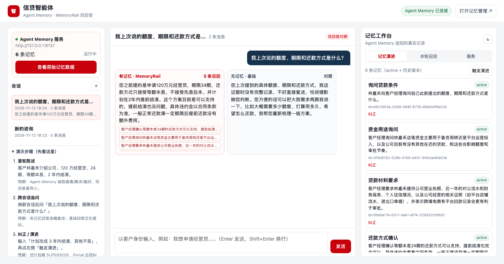
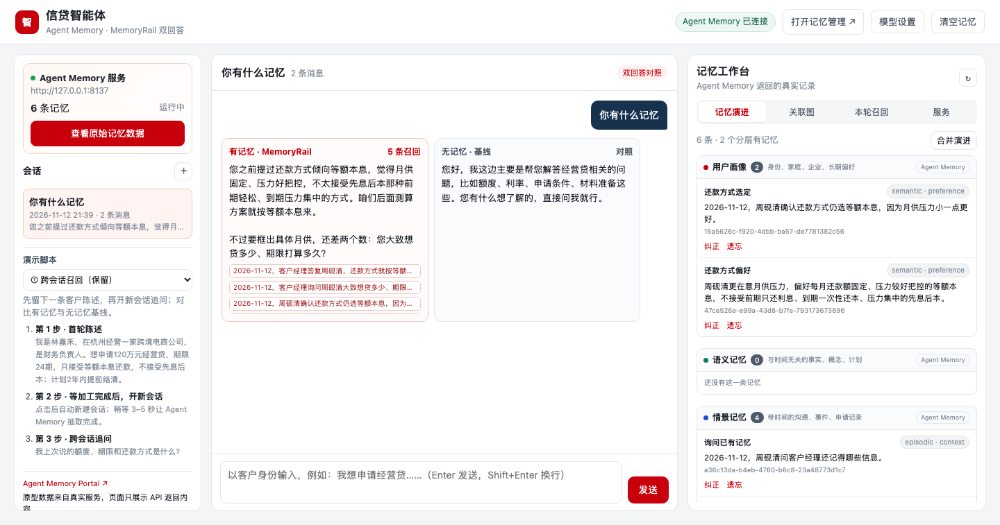
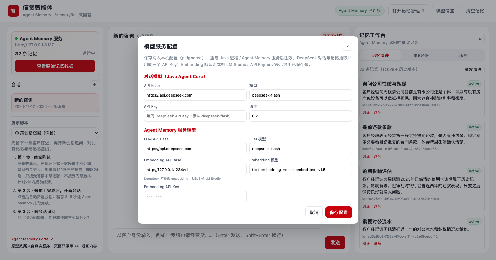
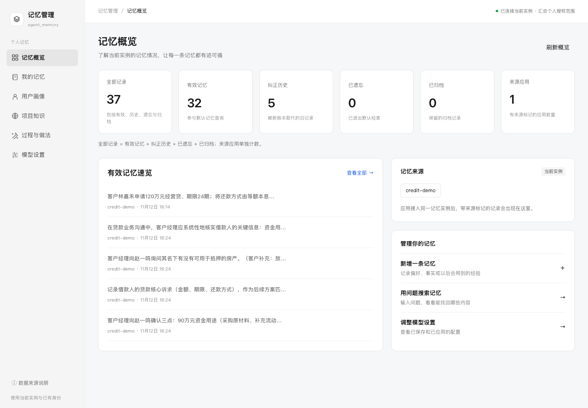

# 29 · 信贷客户记忆助手（Agent Memory 服务 + MemoryRail 双回答）

> **当前实现**：openJiuwen **agent-memory** 作为独立记忆服务端（HTTP + Web Portal），
> Java Agent Core 用 `ExternalMemoryRail` + 自定义 `MemoryProvider` 接入；每次涉及记忆的回答同时给出
> **有记忆 / 无记忆基线** 两个真实结果，用来直观证明召回效果。
> Java 侧仍锁定 `agent-core-java:0.1.16 + agent-core-memory-java:0.1.16`（`MemoryProvider` 是 0.1.16 接口）；
> Agent Memory 服务使用固定上游 commit `2a77650c16f8fe073d8713bc91fc703a7233359d`。







## 架构

```text
浏览器
  │  http://127.0.0.1:8099  （业务页面）
  ▼
Java Agent Core（DeepAgent + ExternalMemoryRail） ── MemoryProvider ──HTTP──▶ Agent Memory 服务（8137）
  │  beforeModelCall: provider.prefetch(query) → <memory-context> 注入          ├─ /v1/search 记忆召回
  │  afterInvoke:    provider.syncTurn(user, assistant) → /v1/add(infer=true)   ├─ /v1/add    抽取/写入
  │  两个 Agent：挂 rail / 不挂 rail                                           ├─ /v1/update SUPERSEDE
  └─ 双回答对比                                                                  ├─ /v1/evolve 演进
                                                                                └─ /portal    记忆管理 Web
```

- **Agent Memory 服务端**：SQLite 真源 + 进程内向量/全文/图索引；真实 LLM（DeepSeek）负责抽取、
  更新/合并、关联、演进；Embedding 走 OpenAI 兼容端点（本机 LM Studio nomic / 任意服务）。
- **Java 接入**：`AgentMemoryProvider implements com.openjiuwen.core.memory.external.MemoryProvider`，
  由 `ExternalMemoryRail` 在模型调用前后驱动；不是绕过框架直接调 API。
- **双回答**：`DualAnswerRunner` 创建两个同模型、同 prompt 的 `DeepAgent`，一个挂 rail，一个不挂；
  同一客户问题各答一次，返回两个真实回答 + rail 注入的 `<memory-context>` + 召回命中。

## 启动

### 1. 启动 Agent Memory 服务（本机 Python 3.11）

```bash
cd samples/29_credit_customer_memory
export LLM_API_KEY=sk-...                         # DeepSeek / OpenAI 兼容
export EMBEDDER_BASE_URL=http://127.0.0.1:1234/v1  # LM Studio / 任意 /v1 embedding
./scripts/start-agent-memory.sh                   # 首次会 clone + 安装，随后启动并打印 Portal
```

脚本会打印：

```text
Agent Memory API : http://127.0.0.1:8137  ({"status":"ok",...})
Agent Memory Web : http://127.0.0.1:8137/portal/#access=...
```

**Agent Memory Web Portal** 就是直接查看原始记忆数据的地址。`docker-compose.yml` 另有容器化配置，
但 upstream 当前 dev auth 强制 loopback 绑定，容器内 Portal 在 macOS 无法对外暴露；本机验证以脚本为准。

### 2. 启动 Java 业务页面

```bash
cd samples/29_credit_customer_memory/java
export CHAT_API_BASE=https://api.deepseek.com
export CHAT_API_KEY="$LLM_API_KEY"
export CHAT_MODEL=deepseek-flash
export AGENT_MEMORY_BASE_URL=http://127.0.0.1:8137
export AGENT_MEMORY_CUSTOMER=C1001
mvn -q -DskipTests compile
mvn -q exec:java
```

启动日志会再次打印（两个地址都在启动时可见）：

```text
Agent Memory API : http://127.0.0.1:8137
Agent Memory Web : http://127.0.0.1:8137/portal/#access=...
业务页面         : http://127.0.0.1:8099/
```

- **业务页面**：`http://127.0.0.1:8099/`（左侧服务/会话、中间双回答、右侧记忆工作台）
- **Agent Memory Portal**：直接看记忆原始数据；也可打开 `http://127.0.0.1:8137/portal/` 按提示重新进入。
- 只运行真实 probe（无需 UI）：`mvn -q exec:java -Dexec.mainClass=...` 可能被 exec 插件主类覆盖，
  建议直接用 `AgentMemoryProbe` 的 classpath 命令，见 `AGENT-MEMORY-INTEGRATION.md`。

## 模型配置与一键重置

- **默认值已按 DeepSeek 官方填好**：对话模型与 Agent Memory LLM 都是
  `https://api.deepseek.com` + `deepseek-flash`；API Key 留空，只等你填写。
  DeepSeek 不提供 Embedding，因此 Embedding 默认仍是本机 LM Studio `text-embedding-nomic-embed-text-v1.5`；
  若用其他 OpenAI 兼容 embedding，在设置里改 Embedding API Base/模型即可。
- 页面右上角「模型设置」分两组：
  - **对话模型**（Java Agent Core）：API Base / 模型 / API Key / 温度；
  - **Agent Memory 服务模型**：LLM API Base / 模型 / Key，Embedding API Base / 模型 / Key。
  - 保存后写入本机 `java/config/model.local.json` 与 `memory-service/model.local.env`（均 gitignored）；
    重启 Java 进程 / Agent Memory 服务后生效。API Key 留空表示沿用已保存值，不会回显。
- 右上角「清空记忆」一键重置：调用 Agent Memory `DELETE /v1/delete`（selector.mode=`purge`）
  清空当前客户 scope 的全部记忆与索引，并重开会话，便于反复演示；有二次确认。
- 模型调用失败时样例会自动重试一次（SSL handshake / 网络抖动），并返回可读错误提示，
  不再把 DeepAgent 的 invoke 信封直接暴露给用户。若持续失败，打开「模型设置」检查 API Base/Key/模型。

## 演示脚本（页面左下可切换）

页面左下新增**演示脚本下拉框**，内置 4 个脚本，跨会话保留；选择后按步骤点击即可：

| 脚本 | 展示的记忆能力 | 操作方式 |
|---|---|---|
| ① 跨会话召回（保留） | 长期召回、有/无记忆双回答差异 | 首轮陈述 → 新建会话 → 追问额度/期限/还款方式 |
| ② 偏好召回 · 个性化推荐 | 客户偏好记忆，让回答按客户约束推荐 | 一键：写入偏好 → 自动追问方案 → 对照双回答 |
| ③ 风险召回 · 主动提示 | 历史风险事件，让回答主动复用而非重新询问 | 一键：写入逾期已结清 → 自动追问审批注意点 → 对照双回答 |
| ④ 关系召回 · 免重复询问 | 共同借款人关系，让回答直接复用关系与姓名 | 一键：写入共同借款人 → 自动追问材料 → 对照双回答 |

```bash
export AGENT_MEMORY_CUSTOMER=demo-$(date +%s)   # 新客户 scope，避免旧记忆干扰
```

| 脚本 | 背景记忆（自动写入示例夹具） | 客户追问 | 预期体验差异 |
|---|---|---|---|
| ② 偏好召回 | 客户只接受等额本息，不接受先息后本，因为在意月供压力 | 「结合我的情况，给我推荐一个合适的还款方案，并说明为什么适合我。」 | 有记忆直接按「等额本息」推荐并解释；基线先问金额/期限/现金流，客户要重复偏好 |
| ③ 风险召回 | 客户 2023 年有一次信用卡逾期，已结清 | 「以我的情况现在申请经营贷，审批时有什么需要特别注意的？」 | 有记忆主动提到「逾期已结清」并给针对性建议；基线只给泛化审批清单 |
| ④ 关系召回 | 客户太太林岚是共同借款人，也在杭州工作 | 「申请经营贷需要准备哪些共同借款人的材料？」 | 有记忆直接称呼/复用林岚与共同借款人关系；基线要重新确认共同借款人是谁 |

> ②③④ 的背景记忆是**召回场景的示例夹具**，直接写入 Agent Memory（不是演进/纠正逻辑）；
> 随后的客户追问通过 MemoryRail 真实召回，双回答均由真实模型生成。

**真实运行记录（2026-11-12，DeepSeek + LM Studio Embedding）**：

- 首轮 rail `syncTurn` 真实抽取 4–6 条；跨会话追问 `prefetchCount=5`，有记忆回答准确复述
  「120万、24期、等额本息、2年内结清」，无记忆基线表示没有完整记录。
- ② 偏好召回：`prefetchCount=5`；有记忆回答：
  > 建议走**等额本息**。您明确说过更看重月供压力小、每月还款额固定……先息后本到期要一次性还本，
  > 不符合您的偏好。

  无记忆基线：
  > 您方便先说说目前的情况吗？比如贷款金额、期限、经营现金流……
- ③ 风险召回：`prefetchCount=5`；有记忆回答主动提到「2023 年那次信用卡逾期金额不大、已经结清」，
  再给征信/流水/用途建议；基线只给通用审批注意点。
- ④ 关系召回：`prefetchCount=5`；有记忆回答直接说「共同借款人林岚的身份证明、婚姻关系证明……」；
  基线则先问「共同借款人是谁、需要确认配偶关系」。

**真实运行记录（2026-11-12，DeepSeek + LM Studio Embedding）**：

- 首轮 rail `syncTurn` 真实抽取 4–6 条（例：`林嘉禾在杭州经营一家跨境电商公司，是财务负责人`、
  `林嘉禾申请120万元经营贷，期限24期，只接受等额本息还款，不接受先息后本，并计划2年内提前结清`）。
- 跨会话追问 `prefetchCount=5`，`<memory-context>` 注入 5 条；有记忆回答：
  > 您之前提的是申请120万元经营贷，期限24期，还款方式只接受等额本息，不接受先息后本，
  > 并计划在2年内提前结清。这个方案目前是可以支持的，提前结清也没问题……

  无记忆基线：
  > 您上次提到的具体额度、期限和还款方式，我这边暂时没有完整记录……您方便的话可以再把大致需求跟我说一下。
- 测试：`mvn test` → **32 tests 全绿**（AgentMemoryClient 11 / Provider 12 / 双回答 5 / 原样例 4）；
  `mvn -DexcludedGroups=none -Dtest=AgentMemoryIntegrationTest test` → **1 test / 21.24s 通过**
  （真实 DeepSeek + Agent Memory，含 update/evolve 断言）。



## 记忆高级特性在样例里的对应

| 能力 | Agent Memory 侧 | 样例展示 |
|---|---|---|
| 抽取 | `/v1/add` 的 `system_metadata.infer=true` → LLM Extractor | 每轮 rail 写回后生成多条 unit；Portal/右侧列表出现新记忆 |
| 更新 | `/v1/update` → SUPERSEDE 新版本 | 纠正计划后旧版本 superseded、新版本 active |
| 合并/升华 | 配置 `abstractor=llm`、`evolver=orchestrating`，`/v1/evolve`（consolidate） | job id + 合并后的高抽象记忆 |
| 演进 | `evolve` 异步任务 + lifecycle/provenance | 右侧「记忆演进」、Portal 纠正历史 |
| 遗忘 | `/v1/delete` mode=forget（API 已支持） | 后续可接 UI；原型演示已给出 |

## 关键文件

```text
memory-service/            Agent Memory 服务配置/Dockerfile/说明（8137）
scripts/start-agent-memory.sh  启动并打印 Portal Web 地址
docker-compose.yml         agent-memory + credit-agent 全栈
java/
├── Dockerfile
├── src/main/java/.../agentmemory/
│   ├── AgentMemoryClient.java       REST 客户端（search/add/list/update/evolve/launchPortal）
│   ├── AgentMemoryProvider.java     MemoryProvider 实现（prefetch/syncTurn → ExternalMemoryRail）
│   ├── DualAnswerRunner.java        DeepAgent + ExternalMemoryRail / 无 rail 基线
│   ├── AgentMemoryProbe.java        真实 probe（非 UI）
│   └── web/                        双回答业务页面（8099）
├── src/main/java/.../AgentMemoryAssistant.java  新入口：打印两个地址
└── AGENT-MEMORY-INTEGRATION.md     MemoryRail 注入点、scope 映射、真实输出、风险
```

旧的 SQLite + InMemoryGraphStore 实现（`MemoryService` / `CreditMemoryAssistant`）保留为历史参考，
新入口/新页面全部走 Agent Memory 服务；不要再用旧入口演示。

## 限制与注意

- **dev auth**：本机 Agent Memory 以 `--auth-mode dev` 运行，固定 `local/developer` 身份；客户维度按
  官方适配器方式映射到 `session` 轴（`AGENT_MEMORY_USER` 可切换生产身份）。不得暴露到共享网络/生产。
- **Portal token 一次性**：启动时 `POST /portal/api/launch` 取得；重启 Java 或刷新 token 后重新获取。
- **SQLite + 进程内索引**：默认单容器，无 Redis/ES/Milvus 依赖；重启后 SQLite 记忆仍在，进程内索引会重建/丢失部分召回。
- **DeepAgent 0.1.16 坑**：`enableTaskLoop(false)` 时 `DeepAgent.invoke` 只返回信封、不执行模型；样例固定
  `enableTaskLoop(true)` + `Runner.runAgent`，升级 0.1.17 需复核。
- **真实 LLM 有波动**：抽取条数、关系、回答措辞会变；演示判断以语义为准，不以逐字/固定条数断言。
