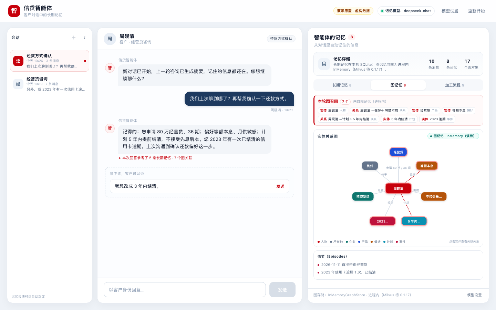

# PROTOTYPE · 信贷智能体 · 客户对话与记忆

> **一次性原型（throwaway），不要合并进 main。** 用来回答一个产品问题，不是生产代码。
>
> **问题**：客户和信贷智能体真实对话后，智能体**记住了什么、记在哪里、本轮用了哪些、图关系长什么样、
> 记忆是怎么加工出来的**？这个演示把回答放在左右两块：最左侧是可收起的历史会话，中间是客户↔智能体对话，
> 右侧是智能体的记忆工作台。



## 30 秒打开

**双击 `index.html`** 即可（零构建、零依赖、不连后端；客户与业务数据均为虚构）。
演示是「对话驱动」的：点聊天区下方的建议气泡，就像客户在说话；右侧记忆会同步更新。

也可以本地起静态服务：

```bash
cd samples/29_credit_customer_memory/prototype
python3 -m http.server 8099
# http://127.0.0.1:8099/index.html
```

截图 / 快速查看入口（不用点）：

```text
index.html?demo=first                 首次咨询 3 轮后的记忆
index.html?demo=recall                新对话追问：长期记忆召回 + 图召回
index.html?demo=deleted               客户改主意 + 删除逾期记录之后
index.html?demo=reopened              模拟重新打开应用，记忆仍在
index.html?demo=reasked               重新打开后再问一次，记忆再次被召回
index.html?demo=recall&tab=graph      直接看「图记忆」tab
index.html?demo=recall&tab=pipeline   直接看「加工流程」tab
index.html?demo=recall&settings=1     打开「记忆模型服务」设置弹层
index.html?demo=reopened&history=1    回看历史会话「经营贷咨询」
index.html?demo=recall&collapsed=1    收起历史会话列表
```

## 界面怎么看

**最左侧 · 历史会话**
所有会话按时间倒序排列，当前会话高亮。点任意历史会话即可回看当时的完整对话；
顶部「＋」开启新对话（完成当前对话后可用），「‹ / ›」把这块区域收起或展开成一条窄边框。
回看历史时聊天区只读，右侧会提示「正在回看历史会话，右侧展示的是智能体当前记忆」。

**中间 · 对话**
客户周砚清与「信贷智能体」的对话。客户消息在右、智能体回复在左；每轮客户消息下方会出现
「接下来，客户可以说」的建议气泡，点「发送」即可继续演示。对话进行到关键节点会出现
「开启新对话」「模拟重新打开应用」等引导。

**右侧 · 智能体的记忆工作台**，分三个 tab：

1. **长期记忆**：存储卡片（本机 SQLite + 进程内图存储）、本轮召回、五类记忆
   （用户画像 / 语义记忆 / 情景记忆 / 摘要记忆 / 变量记忆），每组标注存储位置，
   条目带「刚刚记住 / 已更新 / 本轮用到」状态。
2. **图记忆**：实体关系图可视化（SVG，可点实体看关联关系）、本轮图召回、情节（Episodes）
   列表；当前按方案 B 使用 **InMemoryGraphStore** 演示图记忆（Milvus 持久化待 0.1.17）。
3. **加工流程**：最近一次记忆加工的分步流水线（对话进入队列 → LLM 分析 → 结构化抽取 →
   去重合并 → 写入 SQLite/向量/图存储 → 可召回），并展示**加工样本（会话上下文 → LLM 提炼 → 长期记忆）**、加工记录和当前模型配置摘要。

**右上角 · 记忆模型服务**
点「模型设置」打开弹层，配置记忆抽取/向量化使用的 Provider、API Base、API Key、对话模型、
Embedding 模型、可选 Reranker、温度和图存储地址（Milvus，0.1.17 后启用）；支持「测试连接」（演示态）与保存。
原型配置只存在页面内存；真实样例从环境变量 / 本机配置文件读取，API Key 不入库。

## 推荐演示路径

1. **首次咨询**：依次发送 3 条建议消息，长期记忆与图记忆同时增长。
2. **查看图记忆**：切到「图记忆」tab，能看到实体/关系图和情节列表；点实体节点查看关联关系。
3. **开启新对话**：左侧会话列表新增第二个会话，上一轮生成摘要记忆；客户接着问「我们上次聊到哪了？」。
4. **本轮召回**：长期记忆 tab 出现「本轮召回」，图记忆 tab 出现「本轮图召回」，回答下方显示引用条数。
5. **客户改主意**：发送「我想改成 3 年内结清」，语义记忆/变量变为「已更新」，图关系也会更新。
6. **删除记录**：发送「把 2023 年逾期那条记录删掉吧」，对应长期记忆、图实体和情节同步消失。
7. **重新打开应用**：点「模拟重新打开应用」，记忆仍在；再让客户问一次，召回再次生效。
8. **加工流程**：切到「加工流程」tab，查看最近一次抽取的 LLM 调用次数、新增记忆、图对象和耗时；
   底部可看到当前模型配置摘要与「模型设置」入口。

## 图存储：当前 InMemory，Milvus 已备好

按方案 B 推进：**当前样例使用 0.1.16 全配对 + `InMemoryGraphStore` 演示图记忆**，重启会丢失图数据；
Milvus 作为 0.1.17 发布后的升级目标，Compose 文件已放在样例根目录：

```bash
cd samples/29_credit_customer_memory
docker compose up -d
docker compose ps
# Milvus: localhost:19530；健康检查: http://localhost:9091/healthz
```

数据和容器说明见 [样例根 README](../README.md#基础设施milvusdocker-compose)。原型本身不连任何图存储，
“InMemory（演示）”是当前目标架构，等 `agent-core-memory-java:0.1.17` 发布后切到 Milvus。

## 多路召回：向量 / KV / 图

引擎本身提供的是**按组件**的检索能力，不是开箱即用的跨组件融合：

- `LongTermMemory.searchUserMem`：向量检索 + KV 词面兜底（两路，取 max）；
- `searchUserHistorySummary`：只走向量；
- 变量：`getVariables` 直接读 KV；
- `GraphMemory.search`：实体/关系/情节三个集合，内部也是稠密向量 + 稀疏全文的混合检索，可加重排。

把“向量 + KV + 图”合成一个结果需要宿主/业务层做融合（RRF、加权或规则）。原型在“本轮召回”卡片里
用**向量 / KV / 图记忆**三个来源展示了一次融合召回；真实 Java 样例建议在应用层实现同样的融合器，
并把每个结果的来源标出来。

## 离线记忆抽取：jiuwen 有这个能力

“根据会话上下文，用模型总结提炼形成长期记忆”正是 `LongTermMemory` 的核心能力：

- `LongTermMemory.addMessages(messages, agentMemoryConfig, userId, scopeId, sessionId)`：
  默认 `gen_mem=true`，会读取最近历史消息（默认最近 2 条）→ **LLM 记忆分析**（变量 + 摘要意图）→
  写入摘要/变量 → **LLM 结构化抽取**长期记忆（用户画像/语义/情景）→ 必要时 **LLM 冲突合并**；
  一次交互最多 3 次 LLM 调用。`gen_mem=false` 只存原始消息。
- `GraphMemory.addMemory(EpisodeType, userId, content, ...)`：同样用 LLM 从对话情节里抽取实体/关系，
  合并去重后写入图存储。
- Java 0.1.16 的这些 API 是**同步调用**；样例在对话结束后由应用侧异步触发，就得到“离线加工”的效果。
  原型里的加工流程 tab 把输入上下文、LLM 提炼、产出长期记忆/图对象完整展示出来。

## 自检截图（1440×900）

| 截图 | 看什么 |
|---|---|
| [initial.png](screenshots/initial.png) | 初始状态：智能体问候 + 第一条建议；右侧空记忆引导 |
| [first-memories.png](screenshots/first-memories.png) | 3 轮咨询后的长期记忆与存储位置 |
| [recall.png](screenshots/recall.png) | 新对话追问：本轮召回卡片 + 回答引用记忆 |
| [updated-deleted.png](screenshots/updated-deleted.png) | 更新（旧值可见）与删除后的记忆库 |
| [reopened.png](screenshots/reopened.png) | 重新打开应用后记忆仍在 |
| [reasked.png](screenshots/reasked.png) | 重开后再次召回，记忆继续生效 |
| [history-view.png](screenshots/history-view.png) | 点左侧历史会话回看第一轮对话（只读） |
| [collapsed.png](screenshots/collapsed.png) | 历史会话列表收起后的窄边框 |
| [graph-tab.png](screenshots/graph-tab.png) | 图记忆 tab：实体关系图 + 本轮图召回 + 情节 |
| [pipeline-tab.png](screenshots/pipeline-tab.png) | 加工流程 tab：分步流水线 + 最近一次加工指标 |
| [settings.png](screenshots/settings.png) | 记忆模型服务设置弹层 |

重跑截图（本机无头 Chrome）：

```bash
cd samples/29_credit_customer_memory/prototype
"/Applications/Google Chrome.app/Contents/MacOS/Google Chrome" \
  --headless=new --no-sandbox --disable-gpu --hide-scrollbars \
  --window-size=1440,900 --user-data-dir=/tmp/proto29-chrome \
  --virtual-time-budget=2500 --screenshot=/tmp/proto29.png \
  "file://$PWD/index.html?demo=recall&tab=graph"
```

## 记忆分类的术语说明

右侧长期记忆的分类与 openJiuwen Java SDK 的 `MemoryType` 对齐：

| 界面名称 | jiuwen MemoryType | 含义 |
|---|---|---|
| 用户画像 | `USER_PROFILE` | 客户本人的身份、偏好、关系等稳定表述 |
| 语义记忆 | `SEMANTIC_MEMORY` | 与时间无明确关系的事实、概念、计划（semantic memory） |
| 情景记忆 | `EPISODIC_MEMORY` | 与时间有明确关系的事件、沟通记录（episodic memory） |
| 摘要记忆 | `SUMMARY` | 一轮对话结束后生成的压缩摘要 |
| 变量记忆 | `VARIABLE` | 金额、期数、客户号等结构化字段 |

图记忆是独立于这五类的 **GraphMemory**：维护实体（Entity）/ 关系（Relation）/ 情节（Episode），
由 LLM 抽取并合并去重，召回时按实体/关系/情节集合做混合检索。

## 开发者附注（故意不放进产品界面）

- **版本约束**：`agent-core-memory-java` 只发布到 0.1.16，且与 `agent-core-java:0.1.17` 二进制不兼容
  （23 个消费类 / 119 处符号无法解析）。完整 LongTermMemory 需要 `0.1.16 + 0.1.16` 全配对。
- **图记忆后端**：当前选择方案 B：0.1.16 全配对 + `InMemoryGraphStore`（进程内、重启丢失）。
  `MilvusGraphStore` 是 0.1.17 core 才加入，而 memory 0.1.17 尚未发布；Docker Compose 已准备好，
  等 0.1.17 发布后再切换。
- **记忆加工不是引擎自动离线调度**：0.1.16 的 `LongTermMemory.addMessages(gen_mem=true)` 和
  `GraphMemory.addMemory(...)` 都是同步调用，内部完成 LLM 抽取（LongTermMemory 一次最多 3 次 LLM；
  GraphMemory 另有一次图抽取）；样例在对话结束后由应用侧异步触发，所以 UI 呈现为「离线加工流水线」。
- 记忆分类与存储映射、SQLite 表/键、GraphMemory 限制、API probe 见
  [RESEARCH-MEMORY.md](../research/RESEARCH-MEMORY.md) 与 [RESEARCH-STORAGE.md](../research/RESEARCH-STORAGE.md)。

## 原型没做什么

- 不连后端、不调用真实模型、不连真实图存储；记忆、图、加工流水线由 `src/model.js` 状态机模拟。
- 不实现真实 LLM 抽取、去重合并、敏感信息脱敏。
- 模型设置不真正发起连接测试，也不会持久化 API Key。
- 只保证 1280×800 以上可用；1440×900 为基准。

## 文件

```text
prototype/
├── index.html          入口
├── README.md           本文件
├── screenshots/        1440×900 自检截图
└── src/
    ├── data.js         客户对话、五类记忆、图记忆、加工阶段与默认模型配置
    ├── model.js        纯状态机（记忆/图记忆/召回/加工流水线/模型配置）
    ├── app.js          页面渲染、三个记忆 tab、图可视化、模型设置弹层
    └── styles.css      样式
```

## 下一步

真实 Java 样例已在 [java/](../java/README.md) 落地：长期记忆 0.1.16 全配对 + 本机 SQLite；
图记忆先用 InMemoryGraphStore 演示，等 memory 0.1.17 发布后切 Docker Compose 的 Milvus；模型服务从环境变量或
本机配置文件读取。原型保留作为产品形态参考。
