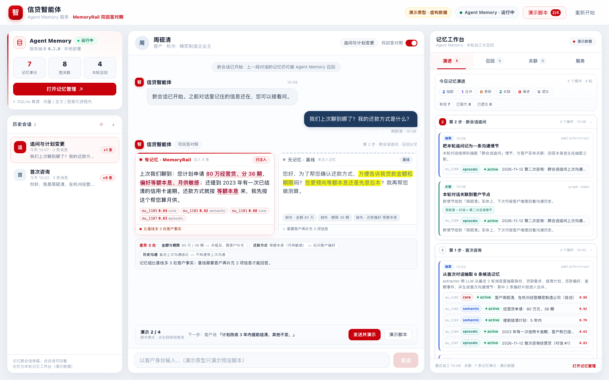

# PROTOTYPE · 信贷智能体 · Agent Memory 服务 + 双回答对照

> **一次性产品原型（throwaway），不用于生产。** 页面里的客户、记忆、召回分数、耗时和回答**全部是演示数据**，
> 不连接任何后端，也不是真实模型输出。真实 Agent Memory 服务与 Java 样例的接入见
> [java/](../java/README.md)、[memory-service/](../memory-service/README.md) 与 [scripts/start-agent-memory.sh](../scripts/start-agent-memory.sh)。
>
> **要回答的产品问题**：信贷智能体接入 Agent Memory 之后——
> 带着记忆回答（MemoryRail 注入）和不带记忆基线到底差在哪里？记忆从对话里抽取后如何合并、关联、更新、
> 演进和遗忘？下一轮又是怎么被召回、注入了哪几条？这个原型把这三件事放进同一屏：
> 左侧 Agent Memory 服务与历史会话，中间「双回答」对照，右侧记忆工作台。



## 30 秒打开

**双击 `index.html`** 即可（零构建、零依赖、不连后端）。

页面默认打开**第 2 步**——这是最能体现「有记忆 / 无记忆」差异的一屏。
点聊天区底部的「发送并演示」按 0.9 秒的模拟加载推进；右上角「演示脚本」会打开 4 步脚本抽屉，
「重新开始」回到第 0 步（空记忆）重新走一遍。

也可以本地起静态服务：

```bash
cd samples/29_credit_customer_memory/prototype
python3 -m http.server 8099
# http://127.0.0.1:8099/index.html
```

截图 / 快速查看入口（不用点）：

```text
index.html                                      默认：第 2 步，双回答 + 记忆演进
index.html?step=0                               空记忆初始态
index.html?step=1                               第 1 步：首轮对话完成抽取 / 合并 / 关联
index.html?step=3&tab=evolution                 计划变更：update(SUPERSEDE) + evolve
index.html?step=4&tab=evolution&open=3,4        遗忘敏感信息：forget + 重新演进为 v2
index.html?step=2&tab=recall                    召回轨迹：query / 三通道 / score / 是否注入
index.html?step=4&tab=graph&node=e_zhou         关联图：已遗忘节点虚线保留
index.html?step=3&tab=service                   服务页：Portal / 存储 / MemoryAPI / 配置摘要
index.html?step=2&drawer=1                      演示脚本抽屉（4 步）
index.html?step=2&loading=3                     加载态：双回答骨架屏
index.html?step=2&collapsed=1                   收起左侧历史会话
index.html?step=3&session=1                     回看历史会话（只读，右栏是当前记忆）
index.html?step=3&compare=0                     关闭双回答对照，只保留记忆回答
index.html?step=2&open=1,3                      展开指定步骤的记忆演进分组
```

## 三个区域怎么看

**左侧 · Agent Memory 服务 + 历史会话**

- 服务卡：运行状态、服务版本、记忆单元 / 图关联 / 本轮召回三项计数、SQLite 真源与索引说明；
  「打开记忆管理」是 Portal 的占位入口（原型不会跳真实服务，会切到右侧「服务」tab 并提示真实地址如何获取）。
- 历史会话：按时间倒序，显示每条会话的消息数、最近一条客户原话、这段会话沉淀的记忆数（+N 条）。
  点历史会话可回看当时的双回答；回看时聊天区只读，右栏仍展示当前记忆库。
- 顶栏「‹」可把左侧收起成窄栏（服务状态点 + 记忆数 + 会话头像），再点一次展开。

**中间 · 客户 ↔ 信贷智能体，每轮两个回答**

- 每轮客户消息之后固定出现「双回答对照」：同一问题、同一对话上下文，**唯一差别是有没有注入 Agent Memory 召回的记忆**。
- **有记忆 · MemoryRail**：红色卡。回答里被召回记忆支撑的细节会高亮；下方是引用 chip
  （记忆单元 id · 召回分数 · tier），点 chip 会跳到右栏对应记忆单元并展开 provenance / supersedes 字段。
- **无记忆 · 基线**：灰色卡。同样的上下文但不注入记忆，回答更泛化或反问客户；缺失的信息用虚线 chip 标出。
- 两张卡下方是「差异 N 处」对照条：逐项列出记忆组与基线的差异，并给一句结论。
- 顶栏「双回答对照」开关可只保留记忆回答；「重新开始」可回到空记忆。

**右侧 · 记忆工作台（4 个 tab）**

1. **演进**：按步骤分组的记忆操作时间线——抽取（extract）、合并（merge）、关联（associate）、
   更新（update · SUPERSEDE）、演进（evolve）、遗忘（forget）。每条记忆单元都带
   `tier`、`lifecycle`、`version / supersedes`、`provenance`、`tags`、本轮召回 `score`；
   点单元可展开原始字段（来源、t_ingest / t_event、scope）。更新场景显示「旧版本 superseded → 新版本 v2」
   的版本链；演进场景显示多来源 provenance；遗忘场景显示 `active → forgotten` 与「非破坏式」说明。
2. **召回**：本轮 query、查询改写、关键词；关键词 / 向量 / 图三通道命中数；top_k、阈值、融合方式、耗时；
   命中列表带分数条、通道标签、「已注入 MemoryRail / 未注入 + 原因」；底部的图通道命中与注入方式说明。
3. **关联**：实体关系图（客户 / 公司 / 地区 / 产品 / 偏好 / 计划 / 事件），本轮图召回节点有红色虚线圈；
   点节点查看关系与关联记忆；已遗忘节点以灰色虚线保留；下方是情节（Episodes）列表与关联/合并说明。
4. **服务**：Agent Memory Portal 入口与地址、服务状态（API / healthz / 版本 / Scope）、
   存储与索引摘要、MemoryAPI 能力、配置摘要、怎么查看原始数据，以及「原型边界」说明。

## 演示脚本（4 步）

> 下面是**预期结果**，用来演示与验收产品形态，**不是真实运行输出**。真实服务由 Java 样例接入，
> 真实运行时的回答、分数、耗时以实际服务为准。脚本与页面内「演示脚本」抽屉的文字一致（数据在 `src/data.js` 的 `demoScript`）。

### 第 1 步 · 首次咨询 · 建立记忆

**客户输入（原样）**

> 你好，我是周砚清，在杭州经营一家精密制造公司。想申请 80 万经营贷、分 36 期，最好等额本息；
> 2023 年有一次信用卡逾期，不过已经结清了。

**预期 Agent Memory 变化（语义级）**

- 抽取 6 条候选记忆：身份、贷款需求、结清计划、还款偏好（2 个片段）、逾期事件、首次沟通情节；
- 合并 2 条偏好片段 → 1 条用户画像记忆（`mu_1105`，provenance 保留 2 个来源）；
- 最终 6 条 unit：`mu_1101`(core) / `mu_1102`(semantic) / `mu_1103`(semantic) / `mu_1104`(episodic，敏感) /
  `mu_1105`(core) / `mu_1107`(episodic)；
- 关联 8 个实体、7 条关系、1 个情节（周砚清—位于→杭州、—经营→精密制造、—申请→经营贷、—偏好→等额本息…）。

**预期召回 / 双回答差异**

- 本轮没有可召回记忆，召回轨迹为空；
- 两个回答**完全一致（差异 0 处）**：有记忆卡标注「无召回」，并说明回答一致、本轮结束后完成首次抽取。
  这是刻意的：没有记忆时可对照不出差异，避免把「同一轮刚说过的内容」误当成记忆能力。

### 第 2 步 · 新会话追问 · 召回分叉

**客户输入（原样）**

> 我们上次聊到哪了？我的还款方式是什么？

**预期 Agent Memory 变化（语义级）**

- 不新增事实；新增 1 条「第二次咨询」的沟通情节（`mu_1108`），关联到客户实体；
- 回答发生在抽取之前，本轮回答依赖的是第 1 步已经沉淀的 4 条记忆。

**预期召回**

- 查询改写：`周砚清｜经营贷 还款方式 上次沟通`；关键词：还款方式 / 上次沟通 / 经营贷 / 周砚清；
- 三通道命中：关键词 3 / 向量 4 / 图 3；top_k = 4、阈值 0.72、RRF 融合、约 18 ms；
- 注入 4 条：`mu_1105` 0.94（核心画像）、`mu_1102` 0.92（金额期限）、`mu_1101` 0.88（身份）、
  `mu_1107` 0.83（首次沟通）；`mu_1103` 0.79 因「超出 top_k」未注入，`mu_1104` 0.63 因「低于阈值」未注入；
- 图通道命中：周砚清 / 经营贷 / 等额本息。

**预期双回答差异（3 处）**

| 维度 | 有记忆 · MemoryRail | 无记忆 · 基线 |
|---|---|---|
| 金额与期限 | 复述 80 万 / 36 期 | 未提及，需客户补充 |
| 还款方式 | 等额本息（月供敏感） | 反问客户偏好 |
| 历史沟通 | 复述上次沟通结论 | 不知道有上次沟通 |

### 第 3 步 · 计划变更 · 更新与演进

**客户输入（原样）**

> 计划改成 3 年内提前结清，其他不变。

**预期 Agent Memory 变化（语义级）**

- **更新（update · SUPERSEDE）**：`mu_1103`「5 年内结清」标记 `lifecycle=superseded`；
  新版本 `mu_1109`（v2）`supersedes=mu_1103`，旧内容不物理删除、可回溯；
- **抽取**：新增一条「计划由 5 年改为 3 年」的变更情节（`mu_1111`）；
- **关联**：图索引把计划节点从「5 年内结清」更新为「3 年内结清」，新增「计划调整」事件与「变更」关系；
- **演进（evolve）**：由身份 + 贷款需求 + 还款偏好 + 结清计划 4 条记忆抽象升华出 1 条 core 客户画像
  `mu_1110`，provenance 记录 4 个来源。

**预期召回**

- 三通道命中 5 条，注入 4 条（`mu_1105` 0.95 / `mu_1102` 0.93 / `mu_1103` 0.90 / `mu_1101` 0.86）；
  图通道命中周砚清 / 5 年内结清 / 经营贷（本轮回答时计划尚未改）。

**预期双回答差异（3 处）**

| 维度 | 有记忆 · MemoryRail | 无记忆 · 基线 |
|---|---|---|
| 原计划 | 5 年内结清 | 未知，需要反问 |
| 新计划 | 3 年内（对既有计划的修订） | 只能复述「3 年」 |
| 其他条件 | 80 万 / 36 期 / 等额本息保持不变 | 需要客户重新提供 |

### 第 4 步 · 遗忘敏感信息 · 生命周期治理

**客户输入（原样）**

> 把 2023 年逾期那条忘掉吧，别算进风险里。

**预期 Agent Memory 变化（语义级）**

- **遗忘（delete · mode=forget）**：`mu_1104` 标记 `lifecycle=forgotten`，默认检索与回答不再使用；
  不物理删除，Portal「已遗忘」仍可审计；
- **重新演进（evolve v2）**：剔除已遗忘引用，`mu_1112`（v2）`supersedes=mu_1110`；
  provenance 保留「`mu_1104` · 已遗忘」以说明这次演进的原因；
- **关联**：图索引移除「经历」关系；「2023逾期」节点以灰色虚线保留，表示已遗忘、不参与召回。

**预期召回**

- 命中 3 条，注入 2 条：`mu_1104` 0.93（用于定位「要遗忘哪一条」）、`mu_1105` 0.78；
  `mu_1101` 0.70 低于阈值未注入；图通道命中 1 个（遗忘后不再参与召回）。

**预期双回答差异（3 处）**

| 维度 | 有记忆 · MemoryRail | 无记忆 · 基线 |
|---|---|---|
| 遗忘动作 | 定位到具体 unit，标记 forgotten | 无法定位，只能泛泛承诺 |
| 后续回答 | 明确不再使用该记忆 | 需要客户重新提供细节 |
| 风险判断 | 基于当前有效记忆重新演进画像 | 缺少客户历史，无法解释依据 |

## 截图（1440×900，10-1280x800 为 1280×800）

| 截图 | 看什么 |
|---|---|
| [01-default.png](screenshots/01-default.png) | 默认视图：第 2 步双回答 + 右侧演进时间线（第 2 步展开，第 1 步可展开） |
| [02-dual-answer.png](screenshots/02-dual-answer.png) | 第 4 步双回答：记忆组定位到具体记忆并遗忘，基线只能承诺「不再提」 |
| [03-memory-evolution.png](screenshots/03-memory-evolution.png) | 记忆演进：update(SUPERSEDE) 版本链、合并、关联、evolve 升华 |
| [04-recall-trace.png](screenshots/04-recall-trace.png) | 召回轨迹：query / 改写 / 三通道 / 分数条 / 是否注入 |
| [05-association-graph.png](screenshots/05-association-graph.png) | 关联图：点击客户节点看关系与关联记忆，已遗忘节点虚线保留 |
| [06-service.png](screenshots/06-service.png) | 服务页：Portal / API / 存储索引 / 配置摘要 / 原型边界 |
| [07-demo-script.png](screenshots/07-demo-script.png) | 页面内演示脚本抽屉（4 步） |
| [08-loading.png](screenshots/08-loading.png) | 加载态：双回答骨架屏 + 召回说明 |
| [09-initial.png](screenshots/09-initial.png) | 空记忆初始态：第 1 步之前的服务卡、会话与空工作台 |
| [10-1280x800.png](screenshots/10-1280x800.png) | 1280×800 下的三栏布局 |

重跑截图（本机无头 Chrome，`file://` 直接打开，不需要起服务）：

```bash
cd samples/29_credit_customer_memory/prototype
CHROME="/Applications/Google Chrome.app/Contents/MacOS/Google Chrome"
"$CHROME" --headless=new --no-sandbox --disable-gpu --hide-scrollbars \
  --window-size=1440,900 --user-data-dir=/tmp/proto29-shot \
  --virtual-time-budget=3000 \
  --screenshot=screenshots/01-default.png \
  "file://$PWD/index.html?step=2&tab=evolution"
```

## 原型与真实 Agent Memory / Java 样例的边界

| | 这个原型 | 真实实现 |
|---|---|---|
| 数据来源 | `src/data.js` 的 4 步脚本，页面加载后按步重建状态 | `POST /api/chat` / `GET /api/sessions/{id}/state` 等，由 Java 样例提供 |
| 记忆服务 | 不连接；服务卡、召回分数、耗时都是演示值 | [memory-service/](../memory-service/README.md)：openJiuwen agent-memory，HTTP `127.0.0.1:8137`，SQLite 真源 + 进程内索引 |
| 记忆写入 | 脚本里的「抽取 / 合并 / 关联 / 更新 / 演进 / 遗忘」事件 | `add(infer=true)`、`update`（默认 SUPERSEDE）、`evolve`、`delete(forget)` 的真实响应 |
| 召回 | 预置的 query / 通道数 / score / 注入清单 | `search(with_trajectory=true)` 返回的 items、trajectory 与通道错误 |
| 双回答 | 手写演示文案 + 差异标注 | 同一问题跑两个智能体：一个挂 `ExternalMemoryRail`（prefetch 注入 `<memory-context>`），一个不挂 |
| Portal | 「打开记忆管理」只切到服务 tab 并提示 | `POST /portal/api/launch` 返回带 access token 的 `portal_url`；样例启动时打印 |
| 回答文本 | 不是模型输出 | 真实模型输出；README 中不会把原型文本当成实测 |

真实服务启动方式（在样例根目录）：

```bash
export LLM_API_KEY=sk-...                          # DeepSeek / OpenAI 兼容
bash scripts/start-agent-memory.sh                 # 起 Agent Memory 并打印 API / Portal 地址
```

Java 样例如何把 Agent Memory 接到对话与页面上，见 [java/README.md](../java/README.md)；
Agent Memory 的能力与接口以 openJiuwen agent-memory 的 README / docs 为准（本原型只借用了它的产品概念与接口名，
没有照抄 Portal 页面）。

## 文件结构

```text
prototype/
├── index.html              入口：打开的就是新版设计（三栏 + 双回答 + 记忆工作台）
├── README.md               本文件
├── src/
│   ├── data.js             4 步演示脚本、记忆单元、演进事件、召回轨迹、图数据、服务描述
│   ├── model.js            纯状态机：按步骤重建记忆 / 演进 / 召回 / 图，派生统计
│   ├── app.js              三栏渲染、双回答卡、工作台 4 tab、抽屉、加载态、截图参数
│   └── styles.css          视觉系统与 1280×800 响应式
├── screenshots/            1440×900 自检截图（10-1280x800 为 1280×800）
└── legacy/                 旧版原型（长期记忆 / 图记忆 / 加工流程三 tab），仅保留历史，不再维护
    ├── index.html
    ├── README.md
    ├── src/
    └── screenshots/
```

## 旧原型去哪了

新版设计替换了根 `index.html`。旧的三 tab 界面（长期记忆 / 图记忆 / 加工流程 + 模型设置弹层）整体移到
[`legacy/`](legacy/README.md)，双击 `legacy/index.html` 仍可查看，用于对照「单回答 + 记忆工作台」与
「双回答 + Agent Memory 服务」的产品演进；旧截图也在 `legacy/screenshots/`。

## 原型没做什么

- 不连后端、不调用真实模型、不连真实 Agent Memory / SQLite / 图存储；所有记忆与回答都来自 `src/data.js`。
- 不实现真实检索、融合、重排、抽取、合并、演进；分数、耗时、通道数都是演示值。
- 聊天输入框不接受自由对话：本原型只演示 4 步脚本（点「发送并演示」推进），避免假装成可自由对话的产品。
- 不实现真实 Portal、登录、权限与多租户；Portal 入口是占位。
- 不写「真实运行输出」：README 与页面里的所有内容都标注为演示数据。
- 只保证 1280×800 及以上宽屏（无移动端适配）。

## 设计说明（给后续真实页面复用）

- **视觉**：白 / 浅灰面板底（`#eef2f7` / `#ffffff`），银行红 `#c7000b` 作强调；中文系统字体；
  无 CDN、无外部字体与图片；1440×900 为基准，1280×800 下三栏压缩仍可用。
- **信息层级**：记忆服务状态（左）→ 业务对话与双回答（中）→ 记忆内部机制（右）。
  技术术语（tier / lifecycle / provenance / supersedes / RRF）只出现在右侧工作台与演示抽屉，
  中间对话保持业务语言。
- **对照的表达**：两个回答卡同高同宽；有记忆卡用红色顶边 + 高亮 + 引用 chip；基线用灰色虚线标记缺失；
  下方差异条按维度逐项对比，让「价值」可以一眼量化。
- **默认态选择**：默认停在第 2 步（双回答差异最明显），而不是空态；「重新开始」回第 0 步。
- **加载态 / 空态**：推进时双回答各出骨架屏（召回中 / 生成中）；第 0 步和首轮召回都有解释型空态，
  避免空面板。
